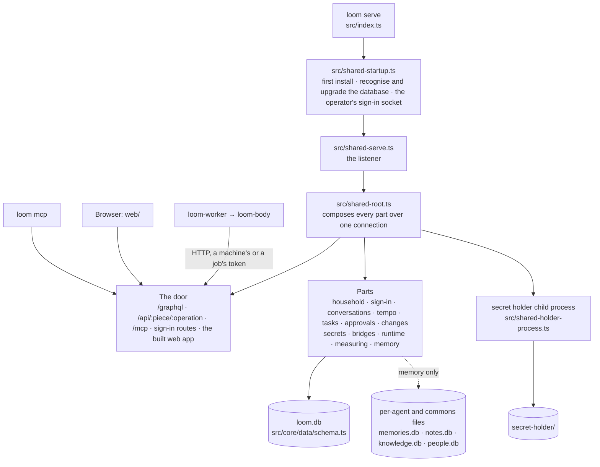

# loom at a glance

What the program is today: what starts it, the parts it is built from, and where every
table lives. For the words used here see `CONTEXT.md`; for the household database's
design see `docs/data-schema.md`.

`src/architecture.contract.test.ts` keeps this page honest in four ways. Every file or
directory named here in backticks must exist. Every table in `src/core/data/schema.ts`
must be named here. Every table created anywhere else in `src/` must be named here too.
And a table named here must still be created somewhere, so a removed store cannot linger
on the page. The test cannot tell whether a sentence is true, so when you move a part,
reread its paragraph.

## What starts

`package.json` installs eight executables. Only `loom serve` opens a household's data.

| Executable | Source | What it does |
|---|---|---|
| `loom serve` | `src/index.ts`, then `src/shared-startup.ts` | Runs the household's program: one process, one HTTP listener, one household database. |
| `loom signin` | `src/index.ts`, then `src/core/signin/operator.ts` | Asks the running program for a one-time sign-in link, over a socket only the data folder's owner can reach. It opens no store. |
| `loom mcp` | `src/index.ts`, then `src/shared-mcp-stdio.ts` | A stdio MCP session that forwards to a running `loom serve` over HTTP. It opens no store. |
| `loom-worker` | `src/worker.ts`, then `src/runtime/worker-program.ts` | Runs on a machine that does work. Asks the program for jobs, starts a body for each, reports back. |
| `loom-body` | `src/body.ts`, then `src/runtime/body-program.ts` | One run of one agent, started only by a worker. Drives a harness (`src/runtime/body-harnesses.ts`). |
| `loom-household`, `loom-taskstore`, `loom-token`, `loom-account`, `loom-sessions` | `src/household-client.ts`, `src/taskstore-client.ts`, `src/token-client.ts`, `src/account-client.ts`, `src/sessions-client.ts`, all over `src/cli` | Command-line clients of the running program's HTTP door. They open no store. |

`loom` accepts `serve`, `signin`, `mcp` (also under its earlier spelling, `--next`),
`--version` and `--help`, and nothing else. The
older program (its own stdio server, a subcommand per verb, server-rendered pages) is
gone, and so are the copies of the household, its tokens, browser sessions and secrets
that it and an earlier composition kept beside the ones that run.

## How `loom serve` is put together

**Startup** (`src/shared-startup.ts`). On an empty home, `src/shared-initialize.ts` builds
the first household beside it and publishes it in one rename. Startup then reads
`program.json` (where the database, the Comms key and the commons files are), recognises
the database read-only, takes ownership of the home, upgrades the database if it is at an
earlier schema number, starts the secret holder, and serves. It makes no sign-in link at
start: it prints the command that asks for one (`loom signin --home <dir>`), which reaches
the running program over a socket only the home's OS user can open.

`program.json` says where things are and what this installation is given. It does not say
who is in the household. Members, owners and agents are rows in `loom.db` and are read from
there each time: a local sign-in that names nobody is for the first current household owner
in the household's order, and Memory has files for every agent in the `agents` table, in
`<home>/agents/<agent>`. A `program.json` from an earlier build also carries `signinMember`
and `memory.sources.agents`; both are still accepted and neither is used, except that a
listed agent whose files are somewhere other than `<home>/agents/<agent>` refuses the start.

**The door** (`src/shared-root.ts`). Every outside caller, whether browser, command-line
client, MCP session, worker or body, comes through one HTTP listener:

- `/graphql` (HTTP and WebSocket) for reads and live subscriptions: `src/next-data.ts` over
  `src/core/data` (`http.ts`, `socket.ts`, `queries.ts`, `subscriptions.ts`). Each table's
  visibility rule is a SQL predicate in `src/core/data/visibility.ts` and its neighbours.
- `/api/:piece/:operation` for every write: a registered operation, checked and given a
  retry receipt by `src/core/operations`, committed through `src/core/data/writes.ts`.
- `/mcp`: `src/shared-mcp.ts` and `src/shared-mcp-named.ts` map MCP tool names onto those
  same operations and queries. It is not a door of its own; a call through it arrives as
  an HTTP call.
- Sign-in routes (`src/core/signin`) and the built web app (`src/shared-web.ts`, from `web`).

Who the caller is comes from `src/shared-credentials.ts` and
`src/core/data/authentication.ts`; what they may do from `src/policy.ts` over the current
facts in `src/shared-sharing.ts`. Parts call each other directly in process and carry no
policy of their own; the `src/shared-*.ts` files are where each part meets the door.

A few rules that every part needs are stated once: the slug pattern and its three lengths
in `src/slug.ts`, how long Comms keeps words in `src/core/data/comms-days.ts` (the limit)
and `src/core/conversations/retention.ts` (when a message's words stop being kept), what an
unset household has (its time zone among them) in `src/core/data/household-settings.ts`,
how a client outside the program reads its address and token in `src/cli/connection.ts`,
and the size of one request in `src/core/data/door-limit.ts`, which the door's three ways
in and `loom-taskstore` share. So are the address a credential may be sent to
(`src/core/private-origin.ts`), when a card's field is stale (`src/backends/cards.ts`), a
merge approval's target (`src/apps/merge-target.ts`), a worker's configuration limits
(`src/runtime/worker-limits.ts`) and the id of a private secret use
(`src/pieces/secrets/use-id.ts`). So are the household's lists and limits that more than
one door takes: the kinds of household change (the keys of `kinds` in
`src/shared-household-proposals.ts`), the memory categories (`src/categories.ts`), a note's
lifespans and the length of its path (`src/notes.ts`), how long a secret grant may last and
what an agent sends to ask for one (`src/pieces/secrets/input.ts`), a secret's standing
answers and the writer of the household's default (`src/pieces/secrets/requests.ts`),
Tempo's timing ranges (`src/core/tempo/volume.ts`), the shape of a SHA-256 digest in hex
and of a sign-in link's path (`src/core/sha256-hex.ts`), a calendar day
(`src/core/day.ts`), the size of a secret's value and the ways one is written
(`src/pieces/secrets/input.ts`), the length of a job's log (`src/runtime/log-tail.ts`),
the most words one message carries (`src/core/conversations/words.ts`), a one-line name
and a machine's name (`src/core/line-name.ts`), the most a memory holds
(`src/backends/types.ts`), and the days that decide a Knowledge page's freshness
(`src/pieces/mind/knowledge.ts`). Two times that must agree are one constant, or one is
worked out from the other in code: how long an unread bridge event and a held message
are kept (`src/pieces/bridges/events.ts`), and how long loom and a worker each give a
relayed sign-in (`src/runtime/account-signin-time.ts`). A choice the database also checks
is read from its column in `src/core/data/schema.ts`. `src/single-home.contract.test.ts`
and `src/stored-data.contract.test.ts` fail when one of these is copied again in the files
they name. The first also reads every number written in the program and the app: the
number of a named limit, written in any file but that limit's home, fails it until the
file either takes the name or is listed there with what its own number means.

Choices that were made on purpose and look like oversights are listed, with why, in
`docs/accepted-tradeoffs.md`.

## The parts

| Part | Where | What it owns |
|---|---|---|
| Household | `src/apps/household.ts`, `src/shared-household-proposals.ts`, `src/shared-projects.ts` | Members, agents, projects, settings; changes an agent proposes for an owner to allow. |
| Sign-in | `src/core/signin`, `src/shared-credentials.ts` | Tokens, browser sessions, one-time links, passkeys, notification devices. |
| Conversations | `src/core/conversations`, `src/shared-conversations.ts` | Conversations, turns, digests, the inbox, threads and their encrypted messages (`src/pieces/comms/crypto.ts`). |
| Tempo | `src/core/tempo`, `src/shared-tempo.ts` | Triggers, their log, pauses, inbox volume and quiet times. |
| Tasks and approvals | `src/apps/tasks.ts`, `src/apps/approvals.ts` and their neighbours in `src/apps` | Tasks, links, comments; permission requests, standing rules, the permanent record. |
| Changes | `src/apps/changes.ts`, `src/pieces/changes` | Pull requests read from GitHub and what was answered about them. |
| Secrets | `src/pieces/secrets`, `src/shared-secret-commands.ts` | Names, grants, requests and uses in the household database; the values only in the holder process. |
| Bridges | `src/pieces/bridges`, `src/shared-bridge-commands.ts` | Discord and Slack connections: what came in, what was sent. |
| Runtime | `src/runtime`, `src/shared-runtime.ts` | Machines, jobs and their placement, model accounts; the worker and body programs. |
| Measuring | `src/core/measuring` | Daily timing roll-ups, off by default. |
| Memory | `src/pieces/mind`, `src/backends`, `src/shared-memory.ts`, `src/shared-notes.ts`, `src/notes.ts` | Memories, person and project cards, notes and knowledge. The only part whose data is outside the household database. |

Memory's files are opened by `src/shared-memory.ts`: the commons from the paths `program.json`
declares, and one directory for each agent in the `agents` table (`householdMemorySources`).
An agent added while the program runs has its files made whole, by the preparation every
agent's files get at start, before any reader is given its name; a removed agent keeps its
row and its files.
`src/backends/sqlite-vec.ts` is the memory store (vector search; embeddings from
`src/backends/fastembed.ts`), `src/backends/sqlite-knowledge.ts` the knowledge store's tables and its upgrade,
`src/backends/people.ts` and `src/backends/projects.ts` the cards over the shared rules in
`src/backends/cards.ts`. A knowledge page is written only through
`src/backends/knowledge-writes.ts`, by the door's page actions (`src/pieces/mind/actions.ts`), which are
the program's only writer of pages, and
a receipt for a write to one of these files only through `src/pieces/mind/receipt-schema.ts`.
`src/backends/salience.ts` and `src/backends/episodes.ts` make the
two slices a body wakes with: Top of Mind, and the tape. The tape's conversation digests
come from the household database, handed in by `src/transport/memory-queries.ts`.

## Where every table lives

A home (`~/.config/loom` unless `--home` or `LOOM_HOME` says otherwise) holds these stores.

### `loom.db`: the household database

Defined once, in `src/core/data/schema.ts`. `assets/data/schema.sql` is generated from it
and creates a fresh database; `upgrades` in `src/core/data/database.ts` brings an older
one to the same shape, and `src/core/data/shipped-shapes` pins the installation SQL of
every schema number. Startup holds a database to the pinned shape of its own number
before it runs any step, and refuses one it does not recognise without writing to it;
`src/core/data/upgrade.test.ts` proves the steps against the same shapes.

| Area | Tables |
|---|---|
| Household | `members`, `agents`, `member_agents`, `projects`, `project_members`, `project_agents`, `project_repositories`, `agent_accounts`, `agent_sprites`, `household`, `backup_recipients`, `member_preferences` |
| Sign-in | `tokens`, `program_tokens`, `program_record_grants`, `program_operation_grants`, `sessions`, `signin_links`, `passkeys`, `notification_devices`, `notification_queue` |
| Tasks | `tasks`, `task_links`, `task_comments` |
| Conversations | `conversations`, `conversation_people`, `turns`, `digests`, `digest_items`, `agent_status`, `conversation_days`, `findings`, `conversation_sessions` |
| Inbox and threads | `inbox`, `inbox_refs`, `inbox_reads`, `action_results`, `threads`, `messages`, `thread_refs`, `deleted_threads` |
| Approvals | `approvals`, `approval_rules`, `approval_notices`, `approval_record` |
| Tempo | `triggers`, `trigger_log`, `program_firings`, `trigger_edits`, `agent_pauses`, `tempo_settings` |
| Changes | `changes`, `change_checks`, `change_people`, `change_tasks`, `change_sync` |
| Observed terminals | `terminal_credentials`, `terminal_sessions`, `terminal_runs` |
| Kits | `agent_kits`, `agent_kit_projects`, `agent_kit_members`, `agent_kit_outside_people`, `project_outside_people`, `kit_uses` |
| Runtime | `model_account_logins`, `machine_reads`, `boxes`, `box_agents`, `box_facts`, `box_readings`, `box_alert_settings`, `jobs`, `job_usage`, `job_needs`, `agent_run_settings`, `agent_boxes`, `agent_house_secrets`, `agent_house_ports`, `agent_people`, `agent_denied_tools`, `model_accounts`, `model_account_windows`, `model_account_boxes`, `agent_models`, `account_signins` |
| Bridges | `bridge_connections`, `bridge_channel_filters`, `bridge_channels`, `bridge_people`, `bridge_incoming`, `bridge_sends`, `bridge_send_parts`, `bridge_send_files`, `bridge_files`, `bridge_file_messages`, `bridge_raw_events`, `bridge_resume` |
| Secrets | `secrets`, `secret_grants`, `secret_requests`, `secret_rules`, `secret_rule_agents`, `secret_uses`, `secret_changes`, `secret_write_journal` |
| Measuring | `timing_days`, `measuring_settings` |
| Bookkeeping | `migrations` (the schema number), `operation_results` (retry receipts) |

### `agents/<agent>/memories.db`: one per agent

| Tables | Made by |
|---|---|
| `memories`, `vec_memories` | `src/backends/sqlite-vec.ts` |
| `proposals`, `memory_revisions`, `memory_supersessions`, `memory_deletions` | `src/backends/migrations.ts` |
| `people`, `person_revisions`, `person_merges`: the agent's relationship cards | `src/backends/migrations.ts`, used by `src/backends/people.ts` |
| `projects`, `project_revisions`, `project_names`: the agent's project cards | `src/backends/migrations.ts`, used by `src/backends/projects.ts` |
| `conversation_turns`, `conversation_digests`, and this file's own `conversations` and `conversation_days` | `src/backends/conversations.ts`. Left from before conversations moved to `loom.db`. Still created, never read or written. |
| `mind_operation_receipts`, `mind_source_migrations` | `src/pieces/mind/receipt-schema.ts`: retry receipts for writes to this file |
| `memory_command_preparations`, `memory_command_receipts`, `memory_command_schema`, `memory_card_references`, `memory_card_schema` | `src/pieces/mind/semantic-schema-sql.ts` |

Four names here (`projects`, `conversations`, `conversation_days`, and `people` in the
commons) also exist in other stores with other columns. A table belongs to the file it is
in; `src/core/data/schema.ts` describes `loom.db` and nothing else.

### `agents/<agent>/notes.db`: one per agent

`notes`, `note_revisions`, `note_files`, from `src/notes.ts`; the attached files sit beside
it, stored once by content. Also `mind_operation_receipts` and `mind_source_migrations`
(`src/pieces/mind/receipt-schema.ts`): retry receipts for `memory.noteWrite`, kept in the
file the note is in.

Set `memory.noteSweepAgent` in `program.json` to schedule expiry for that agent at 04:41
in the household timezone. The field is optional. The sweep keeps pins and permanent notes.
Open and in-progress task text and comments, the agent’s live memories, and active knowledge
pages and their evidence can protect a note by citing its path or an attachment. If a
citation store cannot be read, the sweep leaves the notes in place and tries the next night.

### `commons/knowledge.db` and `commons/people.db`: shared by every agent

| Store | Tables | Made by |
|---|---|---|
| `knowledge.db` | `pages`, `citations`, `supersessions`, `page_supersessions` (attributed replacements within a page), `page_annotations` (disputes and evidence), `page_revisions`, `verifications`, `knowledge_access`, and its own `mind_operation_receipts` and `mind_source_migrations` | `src/backends/sqlite-knowledge.ts`; the receipt tables by `src/pieces/mind/receipt-schema.ts` |
| `people.db` | `people`, `person_revisions`, `person_merges` (the directory half of each person), and its own `mind_operation_receipts` and `mind_source_migrations` | `src/backends/people.ts`, by the same steps in `src/backends/migrations.ts`; the receipt tables by `src/pieces/mind/receipt-schema.ts` |

A new person is two cards, the directory's and the adding agent's, written by
`src/pieces/mind/people-actions.ts`. A refusal or a failure on either side saves neither.
The two files cannot commit as one, so a crash between their commits can leave the agent's
card alone; adding the same person again then finishes the pair
(`src/backends/people-creation.ts`).

### `secret-holder/`: the holder process's own store

`holder_config`, `holder_generation`, `holder_key_history`, `holder_values`,
`holder_receipts`, `holder_aborted_writes`, from `src/pieces/secrets/holder-store.ts`.
Secret values are here, encrypted, and nowhere else.

### How each store knows its version

`loom.db` holds its schema number in `migrations` and is recognised in full before it is
touched. Each of the other stores keeps one number for its own tables in the file header
(`PRAGMA user_version`):

- `memories.db` and `people.db`: how many steps of `src/backends/migrations.ts` the newest
  program to prepare the file knows. Each step still decides from the file's shape whether
  it is pending, and runs whole or not at all; the number only lets an older program refuse
  a file a newer one has changed.
- `knowledge.db`: 1. A newer number, or a file with tables but no `pages`, is refused. What an
  older file lacks is added from its shape (`upgradeKnowledgeStore`).
- `notes.db`: 1. A newer number is refused.
- `secret-holder/holder.db`: 1 (`src/pieces/secrets/holder-store.ts`). A newer number is
  refused by the holder process when it opens the store; a file from before the number was
  kept reads 0, has the same tables, and is marked 1.

The door's bookkeeping in the Memory files is versioned apart from that, in three small
tables that record each numbered step with its text: `mind_source_migrations` (the receipt
table, in every Memory file), and `memory_command_schema` and `memory_card_schema` (in each
`memories.db`). A command compares them with what this program knows before it writes
(`mindReceiptsReady`, `semanticMemoryReady`, `semanticCardsReady`).

Every start of `loom serve` runs these checks on every Memory file before any reader or
command has it (`prepareSharedMemorySources` in `src/shared-memory.ts`, and
`prepareAgentMemory` for an agent added while the program runs): the header number is
compared, the store's pending steps are run, and the bookkeeping tables of a file that has
them are checked and brought up to date. A file a newer program has changed, or whose
bookkeeping is not this program's, stops the start with a line that names the file, and is
left as it is. A fresh file is made whole under a temporary name first. A file that was
already there and never had the bookkeeping tables is not given them; see
`docs/accepted-tradeoffs.md`.

Only `loom.db` and `knowledge.db` are checked for being the right kind of file at all; see
`docs/accepted-tradeoffs.md`.

## Code no program starts

Two things are compiled but reached by no executable, each for a stated reason.

- **The example household.** `src/example-home.ts`, `src/example-home-adapters.ts`,
  `src/example-runtime.ts` and `src/rebuild` build and check a fictitious home. They are
  run by `scripts/example-home.mjs` and the acceptance walkthrough
  (`docs/example-household.md`). The adapters file is loaded by path, from a file the
  example writes into its home, so no import names it.
- **Two files the web app shares.** `src/ui/prose.ts` (the Markdown renderer's rules) and
  `src/ui/project-cards.ts` (the shape of a project's cards) are imported only by `web/src`
  (`web/src/markdown.tsx`, `web/src/kit/markdown.tsx`, `web/src/loom.ts`), which Vite builds
  from source. They are under `src`, so `tsc` compiles them into `dist` with everything
  else there; nothing in `dist` loads them.

An agent's old conversation tables (above) are the one thing kept for the move of an older
home's data. `docs/migration-plan.md` and `docs/migration-registry.md` describe that move;
the commands they name were removed with the older program and are in the repository's
history.

## Elsewhere

- `web`: the browser app, built by Vite into `dist/web` and served by the program.
- `scripts`: build, CI and acceptance scripts. Those that run the program import the build (`dist`), so `npx tsc -p .` comes first. Three import `src` instead, because they are run from source by `tsx` or `vitest`: `scripts/generate-data-schema.ts` (`npm run schema:generate`, which writes `assets/data/schema.sql`), `scripts/rebuild-access-actions.test.mjs` and `scripts/rebuild-work-visibility.test.mjs`. `scripts/ci-runners.test.ts` reads three test files under `src/ui` as text.
- Test fixtures are named `*.fixture.ts` beside the tests that use them, or live in `test/fixtures`; neither is compiled into `dist`.
- `docs/specs`: the designs each part was built from. Several describe the older program; where one disagrees with this page, the code decides.
