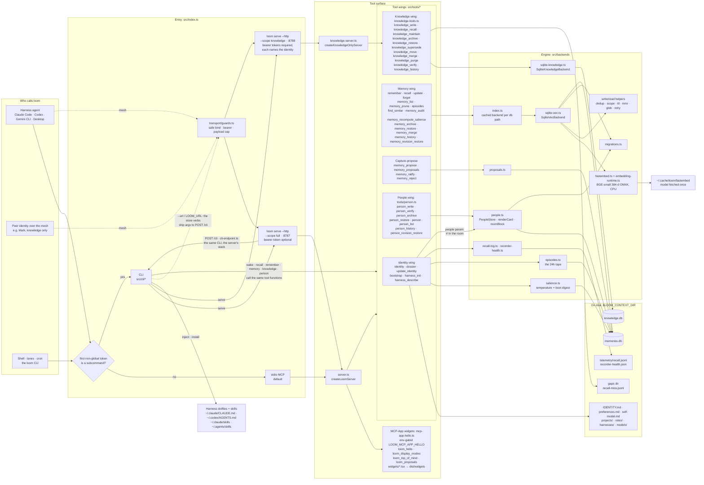
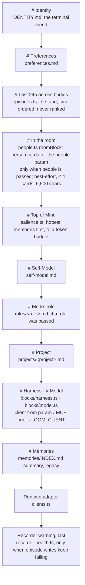
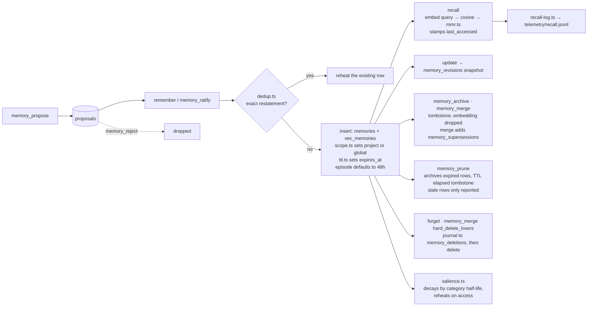
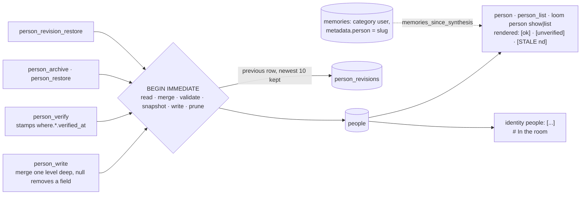

# loom at a glance

Every moving part of loom and where they touch, drawn from the source.
The diagrams are Mermaid, so GitHub renders them in place.

This map is kept honest by `src/architecture.contract.test.ts`. Every
registered MCP tool (including the MCP-App widget tools), every CLI subcommand, every `src/backends/` module
and every SQLite table must be named on this page, or CI fails. When you
add one of those, draw it here in the same PR.

## The whole machine

Two things this picture says that are easy to miss:

- **Memory and knowledge are two stores, two backends, two files.**
  `memories.db` is about the user and the work and is searched by vector.
  `knowledge.db` holds facts about the world and is searched with LIKE.
  `assertKnowledgePathsNotCoLocated` refuses to let them share a file.
- **Person cards live on memory's side of the line.** `people` and
  `person_revisions` are in `memories.db`, next to the `user` memories they
  condense, never in `knowledge.db`. A card is current state (one value
  per field, overwritten; the past only in revisions) and is descriptive,
  never a gate: the harness keeps tiers and scopes in its own file.
- **The knowledge-only server is smaller, not just locked down.** A peer
  on `--scope knowledge` never sees identity or memory tools in its tool
  list, and the knowledge wing pins `created_by` to the identity its
  bearer token resolves to.

## What a body wakes up with

`identity` (`src/tools/identity.ts`) assembles one document from these
parts, in this order. `loom wake` prints the same thing without MCP.

`dossier` is the worker-body version. It returns preferences and
self-model in the third person with a push-back mandate, and leaves the
creed out.

## A memory's life

## A person card's life

The tagged memories stay the evidence; the card condenses them and does not
own them. loom never generates a summary: the agent writes it, and
`person_list`'s `memories_since_synthesis` is how a lane finds the ones that
have fallen behind.

## Where everything is stored

| Store | Tables / files | Backend |
|---|---|---|
| `memories.db` | `memories`, `vec_memories` (sqlite-vec), `proposals`, `memory_revisions`, `memory_supersessions`, `memory_deletions` | `sqlite-vec.ts`, schema moves in `migrations.ts` |
| `memories.db` (people) | `people`, `person_revisions` | `people.ts`, created by the `people_cards` migration |
| `knowledge.db` | `pages`, `citations`, `supersessions`, `page_revisions`, `verifications`, `knowledge_access` | `sqlite-knowledge.ts` |
| Context-dir markdown | `IDENTITY.md`, `preferences.md`, `self-model.md`, `projects/`, `roles/`, `harnesses/`, `models/` | read by `identity`; `update_identity` edits preferences and self-model only |
| Telemetry | `telemetry/recall.jsonl`, `recorder-health.json` | `recall-log.ts`, `recorder-health.ts` |
| Gaps dir (optional) | `recall-miss.jsonl` | knowledge recall misses, input for the expansion lane |

## The pieces, by file

| Module | Job |
|---|---|
| `src/index.ts` | Routes argv to the CLI or the stdio MCP server |
| `src/server.ts` | Full MCP server: registers every wing |
| `src/transport/knowledge-tools.ts` | The knowledge wing, shared by both servers |
| `src/transport/knowledge-server.ts` | Knowledge-only MCP server |
| `src/transport/http-server.ts` | StreamableHTTP front, one server per MCP session |
| `src/transport/guards.ts` | Safe bind, bearer check, payload cap |
| `src/ui/*` | loom's page, at the daemon's root. `core.ts` (loom's own pages and actions), `data.ts` (their queries), `pieces.ts` (running `loom-<piece> ui …`), `vocab.ts` (the page vocabulary and its validation), `render.ts`, `handler.ts` (routes, sessions, the guards on actions) |
| `src/transport/cli-endpoint.ts` | `POST /cli`: runs a store verb's argv through `runCliLocal` (no remote mode on its path) on the server's stack (full scope only) |
| `src/transport/mcp-app-hello.ts` | Env-gated MCP-App widget probes |
| `src/tools/*` | One file per MCP tool (the eight person tools share `person.ts`); the CLI calls these too |
| `src/cli/*` | One file per subcommand |
| `src/cli/pieces.ts` | `loom <piece>`: git-style dispatch to `loom-<piece>` on PATH; `loom pieces` lists them |
| `src/ui/household-pages.ts` | The owner's household page: Home across every agent, the commons' knowledge, People with every agent's relationship, each agent's Setup (identity, tokens, health), adding an agent |
| `src/bundle.ts`, `src/cli/bundle.ts` | The bundle (docs/specs/household.md, "Export and restore"): `loom export` / `loom restore` / `--drill`, age-encrypted, with each piece's own part from `loom-<piece> bundle export` / `bundle import` |
| `src/household.ts`, `src/cli/household.ts` | The household (docs/specs/household.md): `household.json`, `tokens.json` (roles `agent:`, `owner`, `peer:`; only sha256 stored), the resolver the daemon uses per request, `loom household` and `loom token` |
| `src/cli/remote.ts` | Remote mode: with `--url`/`LOOM_URL`, the store verbs run on a loom-http via `POST /cli` |
| `src/blocks/*` | Harness and model manifest blocks for the identity payload |
| `src/injection/*` | `loom inject`: managed `loom:start`/`loom:end` block in harness dotfiles |
| `src/install/*` | `loom install`: copies the setup skill into the harness skills dir |
| `src/backends/index.ts` | Factory: cached backend per db path, one embedder per model |
| `src/backends/types.ts` | `MemoryBackend`, `EmbeddingProvider`, `KnowledgeBackend` interfaces |
| `src/backends/sqlite-vec.ts` | Memory store: SQLite + sqlite-vec cosine search |
| `src/backends/fastembed.ts` | `EmbeddingProvider` adapter |
| `src/backends/embedding-runtime.ts` | Vendored ONNX + tokenizer runtime |
| `src/backends/sqlite-knowledge.ts` | Knowledge store |
| `src/backends/migrations.ts` | Versioned schema migrations for `memories.db` |
| `src/backends/salience.ts` | Temperature and the Top of Mind digest |
| `src/backends/episodes.ts` | The episode tape |
| `src/backends/proposals.ts` | Capture-propose queue |
| `src/backends/people.ts` | Person cards: validation, render, store, the identity room block |
| `src/backends/people-household.ts` | Person cards in a household: the commons directory (name, handles, facts) plus each agent's relationship (summary, how it talks to them, may), merged on read, split on write, and the one-time split of an existing agent's cards |
| `src/backends/dedup.ts` | Write-time exact-restatement key |
| `src/backends/scope.ts` | Project vs global visibility |
| `src/backends/ttl.ts` | TTL parsing and expiry |
| `src/backends/mmr.ts` | Diversity re-ranking for recall |
| `src/backends/glob.ts` | Title patterns for bulk forget |
| `src/backends/retry.ts` | Retry on SQLITE_BUSY |
| `src/backends/recall-log.ts` | Local recall observation log |
| `src/backends/recorder-health.ts` | Episode-write failure ledger |

CLI subcommands: `wake`, `recall`, `remember`, `forget`, `update`,
`memory`, `knowledge`, `person`, `update-identity`, `bootstrap`, `serve`, `inject`,
`harness`, `install`, `doctor`, `migrate`, `pieces`, `household`, `token`, `export`, `restore`. Any other name runs an
installed piece, `loom-<name>` on PATH (`src/cli/pieces.ts`, docs/extensions.md).
