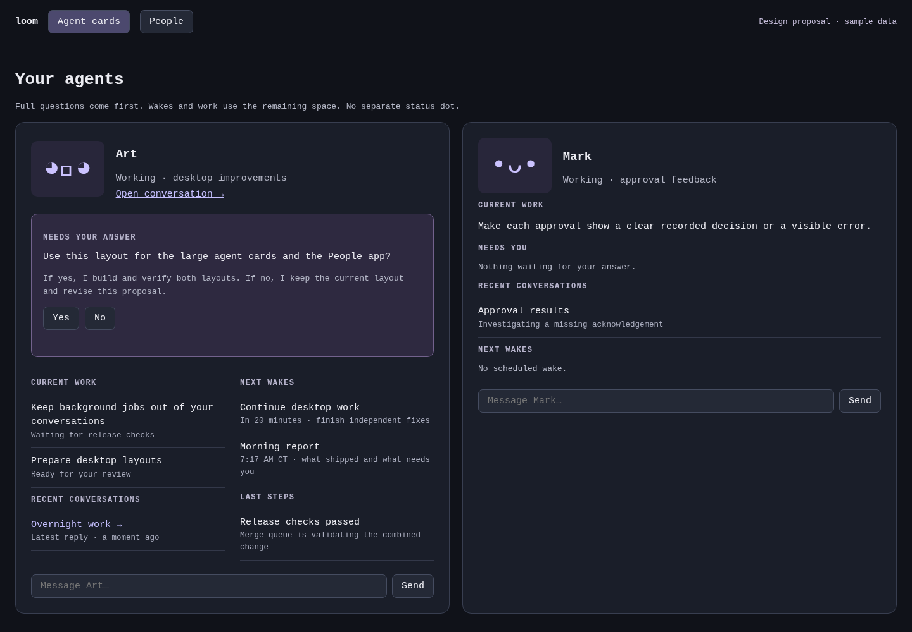
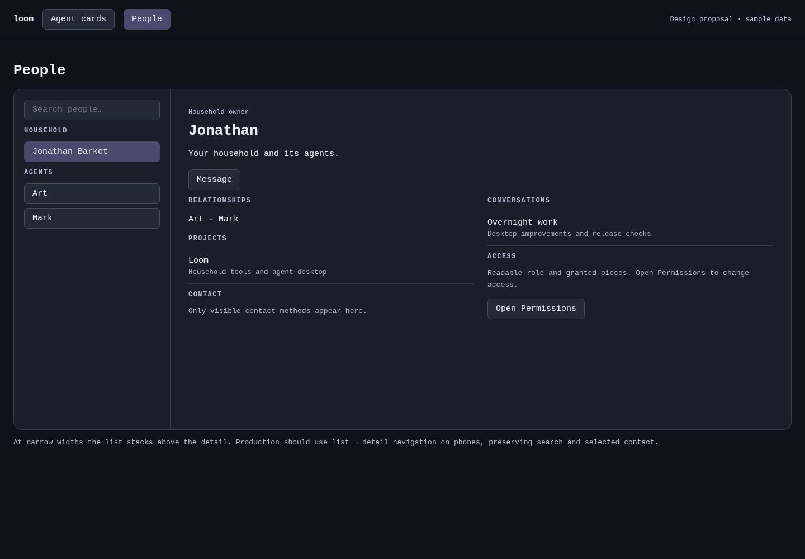

# Desktop layout proposals

Design only; production implementation waits for Jonathan's agreement.

## Large agent cards

Questions and consequences take priority, followed by work, conversations, wakes and recent steps. The second card shows the quiet/no-question case. Faces are placeholders; production keeps the existing pixel faces.

## People

Searchable household/agent list beside a selected person's relationships, projects, conversations and access. On phones, implementation should use list-to-detail navigation preserving search and selection; the sample stacks the panes.

Download [the interactive HTML](overnight-desktop.html) and open it in a browser. All data is sample data; controls send no messages, decisions or access changes.

Browser evidence: both views at 1440, 900 and 390 CSS pixels have no page overflow. Searching Mark leaves exactly Mark visible; choosing him updates the detail. A sample Yes shows a receipt and disables both answer buttons. The first browser check caught display:block overriding hidden on contact rows; the explicit hidden rule fixes it.
